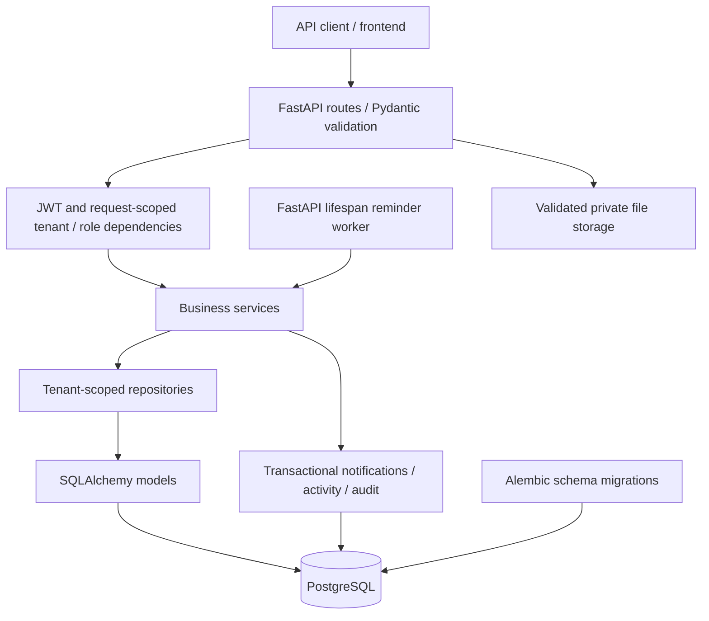

# Backend architecture

`app/routers` defines HTTP contracts; `app/dependences` resolves the authenticated account, active organization and role, and resource permissions. `app/services` owns workflow, assignment, dependency, organization/member, comment, file and dashboard rules. `app/repositories` builds scoped queries. `app/models` defines persistence and `app/schemas` validates API contracts.

Memberships carry tenant-specific roles. `Actor` wraps the persisted account per request and prevents organization selection from mutating global account data. Organization/resource checks precede mutations. Background reminders open their own database session; resource events are committed with their changes. Unique constraints and row locks protect refresh rotation, dependency graphs, assignment membership checks and repeated reminder deliveries.

Files remain private on disk and are streamed only after authorization. API failures use a single structured error envelope. Secret or validation input values are not included in validation errors.
