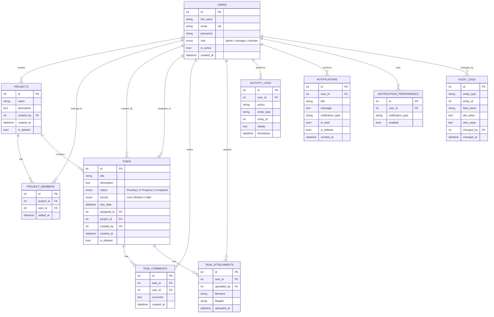

# Database Schema Diagram

Rendered automatically by GitHub when viewing this file as a Mermaid ER diagram.

## Relationship Notes

- **Users to Projects**: one-to-many via `Project.created_by`. A project always has exactly one creator.
- **Users to Projects membership**: many-to-many through `ProjectMember`, with `(project_id, user_id)` unique.
- **Projects to Tasks**: one-to-many. The API uses soft delete, while ORM cascades help with hard-delete cleanup.
- **Users to Tasks assignment**: one-to-many via nullable `Task.assigned_to`.
- **Tasks to Comments and Attachments**: one-to-many, cascade-deleted with the parent task at the ORM level.
- **ActivityLogs**: append-only audit trail using `entity_type` and `entity_id` for loose references (records *actions*, e.g. `TASK_CREATED`, `LOGIN`).
- **Notifications**: one-to-many from User; soft-deleted via `is_deleted` rather than hard-deleted, so a user's notification history survives even after they clear their inbox. `notification_type` matches the `NotificationType` enum and is used to check `NotificationPreference` opt-outs before a notification is created.
- **NotificationPreferences**: one-to-many from User, unique on `(user_id, notification_type)`. Absence of a row means the notification type defaults to enabled; a row with `enabled=false` is an explicit opt-out.
- **AuditLogs**: distinct from ActivityLogs — records *field-level state transitions* (old value -> new value) rather than actions. Loosely referenced via `entity_type`/`entity_id`, same pattern as ActivityLogs, so both Task and Project changes share one table. A row is only written when the old and new values actually differ.
