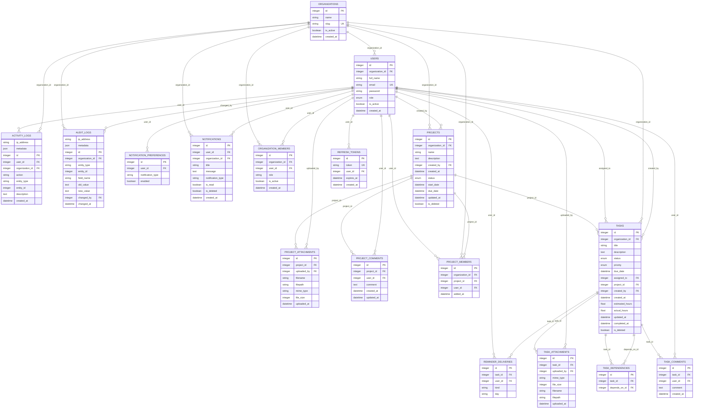

# Database ER diagram

Generated from the SQLAlchemy models. Roles are stored as enums on accounts and tenant-specific strings on organization memberships. Comments/files inherit tenant authorization from their project or task.

Organization and project memberships have unique `(organization_id, user_id)` and `(project_id, user_id)` pairs. Task dependency pairs are unique with a self-reference check. Refresh token hashes and organization slugs are unique. Reminder deliveries are unique by task/user/type/UTC day. Foreign keys and ORM cascades define cleanup; projects/tasks use soft delete through the API. Global super-admin authentication events may have no organization.
